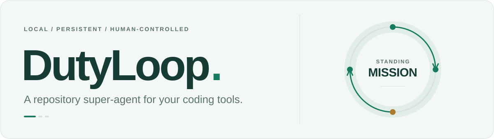
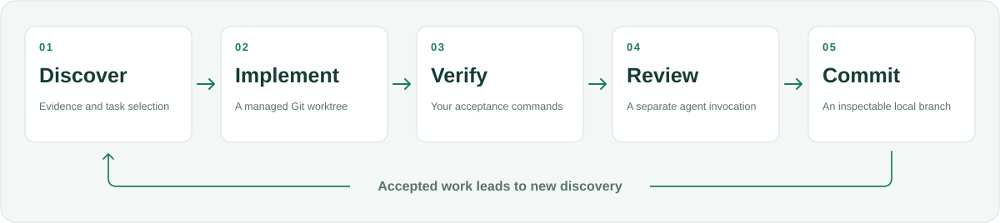

<p align="center">
  <picture>
    <source media="(prefers-color-scheme: dark)" srcset="docs/assets/hero-dark.svg">
    <source media="(prefers-color-scheme: light)" srcset="docs/assets/hero-light.svg">
    
  </picture>
</p>

<p align="center">
  <strong>Give your coding agent a standing responsibility.</strong><br>
  Discover useful work. Implement a change. Check it. Review it. Keep going.
</p>

<p align="center">
  <a href="https://github.com/K-kiron/dutyloop/actions/workflows/ci.yml"></a>
  <a href="https://www.python.org/downloads/"></a>
  <a href="#project-status"></a>
  <a href="LICENSE"></a>
</p>

<p align="center">
  <strong>English</strong> · <a href="README.zh-CN.md">简体中文</a><br>
  <a href="#quick-start">Quick start</a> ·
  <a href="#run-a-project-mission">Run a mission</a> ·
  <a href="#process-github-issues">Process issues</a> ·
  <a href="docs/getting-started.md">Documentation</a> ·
  <a href="https://github.com/K-kiron/dutyloop/issues/new/choose">Report an issue</a>
</p>

---

DutyLoop is a local supervisor for coding agents with an ongoing job to do. Give it a repository, a mission, and your checks. It repeatedly inspects the project, selects work supported by evidence, and develops one change at a time.

Accepted changes accumulate on a **separate local Git branch**, with task rationale, verification results, and review records. Discovery continues after each accepted task, until a limit, blocker, or your stop command ends the run.

Already have a backlog? [Issue mode](#process-github-issues) captures open GitHub issues, plans and implements eligible work, and sets aside items needing your decision. Delivery defaults to local branches; you can explicitly enable PR creation, CI-gated merging, and verified issue closure.

## How it works

<picture>
  <source media="(max-width: 600px) and (prefers-color-scheme: dark)" srcset="docs/assets/workflow-mobile-dark.svg">
  <source media="(max-width: 600px) and (prefers-color-scheme: light)" srcset="docs/assets/workflow-mobile-light.svg">
  <source media="(prefers-color-scheme: dark)" srcset="docs/assets/workflow-dark.svg">
  <source media="(prefers-color-scheme: light)" srcset="docs/assets/workflow-light.svg">
  
</picture>

You define the responsibility and acceptance commands once. DutyLoop manages the worktrees, call reservations, staged-snapshot checks, review invocation, and durable state around your existing coding CLI.

| Capability | What it gives you |
| --- | --- |
| **Ongoing discovery** | One to three workers inspect current evidence and propose tasks with acceptance criteria. |
| **Focused delivery** | Implementation and acceptance stay serial, with managed worktrees for each attempt. |
| **Checks you control** | Your commands run against materialized staged files; changes during verification prevent acceptance. |
| **Inspectable results** | Accepted commits, verified tree IDs, task feedback, and retained rejected or interrupted attempts. |
| **Persistent control** | SQLite state, audit events, background execution, explicit stop, and acknowledged recovery. |
| **Bounded execution** | Invocation and elapsed-time limits, with room reserved for implementation and its mandatory review. |

Standing missions produce local branches without pushing, opening PRs, merging, or deploying. Issue mode also defaults to local output and offers separately configured GitHub delivery.

## Quick start

**Requirements:** Python 3.11+, Git, and a configured Git author identity. Use a virtual environment if possible; [setup instructions](docs/getting-started.md#prerequisites) cover Windows, macOS, and Linux. Installation currently uses the source repository.

```console
git clone https://github.com/K-kiron/dutyloop.git
cd dutyloop
python -m pip install -e .
dutyloop demo --directory ../dutyloop-demo
```

Use a new or empty demo directory. No model account or API key is needed. The **scripted demo** exercises the real supervisor, Git worktrees, and test commands: two fixture fixes are accepted, discovery continues, and the run stops at seven invocations. The driver and its judgments are simulated.

The returned JSON includes:

```json
{
  "simulated": true,
  "accepted_tasks": 2,
  "original_unchanged": true,
  "accepted_tests_passed": true
}
```

This is an excerpt of the demo result. Full output also contains the mission snapshot and artifact locations. See the [verification record](docs/validation.md) for the distinction between offline checks and authenticated host runs.

## Run a project mission

A useful mission names a responsibility and the behavior to preserve:

> Maintain CSV import/export reliability. Fix reproducible failures against
> documented behavior with regression coverage. Preserve the public API and
> file format. Wait when there is no evidenced work.

Install and authenticate a [supported coding CLI](#host-adapters) using its own setup. Choose a repository with a committed `HEAD` and checks that work from a fresh worktree. Save this as `mission.json` **outside the target repository**:

```json
{
  "mission": "Maintain CSV import/export reliability. Fix evidenced failures with regression tests. Preserve the public API and file format. Wait when there is no supported work.",
  "project": "/absolute/path/to/project",
  "allowed_paths": ["src", "tests"],
  "verification": [
    ["python", "-B", "-m", "unittest", "discover", "-s", "tests", "-v"]
  ],
  "driver": {"name": "codex"},
  "limits": {"max_invocations": 12, "max_wall_seconds": 1800}
}
```

Replace the project path, allowed paths, and check command for your project. Windows paths can use forward slashes, such as `C:/work/my-project`. The [full example](examples/mission.json) adds constraints, work kinds, and retry settings; the [configuration reference](docs/configuration.md) covers every field.

Check the setup, initialize, and run:

```console
dutyloop doctor --driver codex --project /absolute/path/to/project
dutyloop validate --spec mission.json --state ../mission-state
dutyloop init --spec mission.json --state ../mission-state
dutyloop run --state ../mission-state
```

`doctor` checks installation and version, without authenticating or calling a model. `init` creates the mission branch and persisted state from committed `HEAD`; uncommitted edits are not copied into the mission. Keep state outside the target repository, and make dependencies available to its fresh worktrees.

### Monitor and control

Use `start` **instead of `run`** to launch a detached process:

```console
dutyloop start --state ../mission-state
dutyloop status --state ../mission-state --human
dutyloop events --state ../mission-state --limit 20
dutyloop stop --state ../mission-state
```

Status shows the mission branch, accepted commit, call usage, and task outcomes. Stopping is asynchronous; check status again to confirm completion. A latched stop cannot be cleared by restarting. [Operations and troubleshooting](docs/operations.md) cover blockers, limits, and interrupted work.

## Process GitHub issues

Use an existing codebase, authenticated coding CLI, and authenticated GitHub CLI (`gh`). Copy [the issue configuration](examples/issues.json) outside the target repository, set the project, repository, allowed paths, and checks, and keep `github.delivery` set to `local` for local results:

```console
dutyloop issues init --spec issues.json --state ../issue-state
dutyloop issues run --state ../issue-state --plan-only
dutyloop issues status --state ../issue-state --human
dutyloop issues run --state ../issue-state
```

Initialization captures the current open issues and their comments without model calls or GitHub writes. Planning consumes the batch's call budget. Execution respects issue dependencies, applies the same verification and review gates as missions, and leaves `needs_decision` items for you while continuing eligible work. `queue.batch_size` bounds each run; the total call and time limits persist across runs.

Set `github.delivery` to `pull_request` to publish PRs, or `merge` with explicit `required_checks` to wait for CI and merge. With `close_issues: true`, merge mode checks the merged tree and reruns your checks before closing an unchanged issue. Running or starting a batch authorizes its configured delivery operations. Uncertain effects require inspection, and a completed pass can still contain unresolved issues.

Automatic merge also requires readable, existing branch protection that enforces up-to-date required checks for administrators. DutyLoop does not change that policy; local and PR modes work without it.

See [the issue workflow guide](docs/issues.md) for configuration, background execution, decisions, recovery, and delivery boundaries. Coverage is currently offline; an authenticated real-project issue batch has not been verified.

## Where it fits

| Responsibility | Useful inputs | Deliverable |
| --- | --- | --- |
| **Library or CLI maintenance** | Source, tests, documented behavior, reproducible defects | Focused fixes and regression tests |
| **A bounded product area** | Committed feedback, reproducible user journeys, explicit product constraints | Changes with stated acceptance criteria |
| **Documentation upkeep** | Current implementation, examples, and documentation | Checked corrections and working examples |

Supply the evidence and business direction your chosen agent needs. Weak evidence can lead to waiting; missing product decisions can lead to a blocker. For a source-backed comparison with other supervisors, see [alternatives](docs/alternatives.md).

## Host adapters

DutyLoop uses existing host installations and authentication. Choose the adapter through `driver.name`; optional MCP control uses the same mission engine.

| Integration | Adapter | Verification coverage |
| --- | --- | --- |
| **Codex CLI** | Native structured output | Offline protocols + one historical authenticated fixture mission |
| **Claude Code CLI** | Native structured output | Offline protocols |
| **OpenCode 2.2.5** | Native, version-pinned JSON events | Pinned-source inspection + offline protocols |
| **DeepSeek Harness 0.2.2-rc.1** | Native, version-pinned headless execution | Pinned-source inspection + offline protocols |
| **Custom command** | Operator-owned JSON wrapper | You validate the wrapper and its host |
| **MCP client** | Optional local stdio control | Official SDK protocol tests; manual client setup |

OpenCode and DeepSeek Harness reject unsupported versions before model work. DeepSeek Harness uses its existing headless profile; omit `driver.model`. Authenticated missions are not yet recorded for Claude, OpenCode, or DeepSeek Harness. OpenHands and other hosts currently need a custom wrapper.

<details>
<summary><strong>Use optional MCP control</strong></summary>

```console
python -m pip install -e ".[mcp]"
dutyloop mcp --root ../mission-states --allow-project /absolute/path/to/project
```

Tools: `mission_create`, `mission_start`, `mission_status`, `mission_events`, and `mission_stop`. Creation does not start work. Configure your client and project allowlist as described in [MCP setup](docs/mcp.md). The MCP interface controls standing missions; use the CLI for issue batches. MCP compatibility alone does not provide a native execution adapter for another host.

</details>

## Project status

**Alpha, with explicit operating boundaries.** Offline behavior tests, a scripted end-to-end demo, and the recorded host checks cover specific control contracts. Long-term usefulness and reduced maintainer effort still need real-project evaluation; comparative effectiveness has not been established.

The issue workflow has offline queue and delivery coverage, without an authenticated real-project batch. Claude Code phases use fresh processes and available committed project instructions; resuming an existing conversation and loading installation-specific automatic memory have not been verified.

- **Limits:** invocations count outer driver calls, not each host request or
  subagent. Wall time includes waiting and downtime after the first run.
- **Cost:** USD hard caps are unsupported. Unknown usage or cost stays unknown.
- **Permissions:** allowed paths constrain acceptance. Worktrees share the
  host's filesystem, network, credentials, and Git access; they are not a sandbox.
- **Verification:** use trusted, non-mutating check commands. Tests an agent
  can rewrite and a separate model review do not establish independent correctness.

Keep mission state and transcripts private. Read [limits and host support](docs/limits-and-hosts.md) and the [verification record](docs/validation.md) before choosing an unattended scope.

## Documentation

| Guide | Start here when you want to… |
| --- | --- |
| [Getting started](docs/getting-started.md) | Prepare a project, run a mission, and inspect its branch |
| [Configuration](docs/configuration.md) | Set paths, checks, constraints, drivers, and limits |
| [GitHub issues](docs/issues.md) | Plan a backlog, handle decisions, and configure PR/merge delivery |
| [Examples](examples/README.md) | Adapt a maintenance or documentation mission |
| [Operations](docs/operations.md) | Monitor events, stop work, and handle recovery |
| [Adapter protocol](docs/adapter-protocol.md) | Build a host wrapper or understand native contracts |
| [Architecture](docs/architecture.md) | Understand discovery, acceptance, and persistent state |
| [Changelog](CHANGELOG.md) | Follow project changes |

## Contributing

Reproducible bug reports, adapter contract tests, and checked examples are particularly useful. [Open an issue](https://github.com/K-kiron/dutyloop/issues/new/choose) with a sanitized reproduction or a concrete workflow, or read [CONTRIBUTING.md](CONTRIBUTING.md) for development setup and required checks. Default tests use local fixtures and simulated drivers; authenticated host experiments should be labeled separately.

## License

[MIT](LICENSE) · Copyright © 2026 Wenhao XU.
