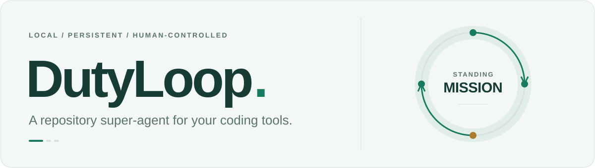
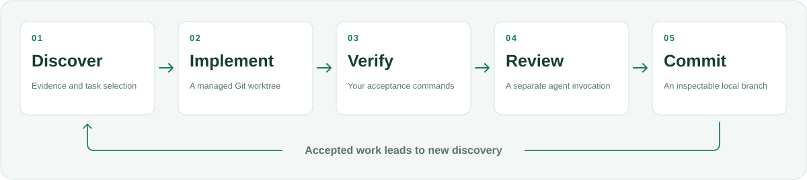

<p align="center">
  <picture>
    <source media="(prefers-color-scheme: dark)" srcset="docs/assets/hero-dark.svg">
    <source media="(prefers-color-scheme: light)" srcset="docs/assets/hero-light.svg">
    
  </picture>
</p>

<p align="center">
  <strong>交给开发 agent 一份持续负责的工作。</strong><br>
  发现工作 · 实施 · 验证 · 复核 · 持续迭代
</p>

<p align="center">
  <a href="https://github.com/K-kiron/dutyloop/actions/workflows/ci.yml"></a>
  <a href="https://www.python.org/downloads/"></a>
  <a href="#项目状态"></a>
  <a href="LICENSE"></a>
</p>

<p align="center">
  <a href="README.md">English</a> · <strong>简体中文</strong><br>
  <a href="#快速开始">快速开始</a> ·
  <a href="#运行项目任务">运行项目任务</a> ·
  <a href="docs/getting-started.md">文档</a> ·
  <a href="https://github.com/K-kiron/dutyloop/issues/new/choose">报告问题</a>
</p>

---

DutyLoop 是面向开发 agent 的本地编排工具，让它围绕一份持续职责工作。 给它一个仓库、一份职责说明和验收命令，它就会反复检查项目，选择有证据支持的工作，逐项实施改动。

通过验收的改动会积累在**独立的本地 Git 分支**上，并保留任务依据、检查结果和复核记录。 每项任务通过后，DutyLoop 会继续发现工作，直到达到运行上限、遇到阻塞，或收到你的停止指令。

## 工作流程

<picture>
  <source media="(max-width: 600px) and (prefers-color-scheme: dark)" srcset="docs/assets/workflow-mobile-dark.svg">
  <source media="(max-width: 600px) and (prefers-color-scheme: light)" srcset="docs/assets/workflow-mobile-light.svg">
  <source media="(prefers-color-scheme: dark)" srcset="docs/assets/workflow-dark.svg">
  <source media="(prefers-color-scheme: light)" srcset="docs/assets/workflow-light.svg">
  
</picture>

你一次性定义职责和验收命令。DutyLoop 围绕现有的开发 CLI，管理 worktree、调用额度预留、 暂存快照检查、复核调用和持久状态。

| 能力 | 带来的作用 |
| --- | --- |
| **持续发现工作** | 1–3 个发现 agent 检查当前证据，提出带有验收标准的候选任务。 |
| **专注交付** | 实施和接纳保持串行，每次尝试使用受管理的 worktree。 |
| **由你掌握的检查** | 将暂存文件还原为可运行的快照后执行你的命令；检查期间发生改动时，不予接纳。 |
| **可审阅的结果** | 已接纳的提交、经检查的 Git 树 ID、任务反馈，以及保留的拒绝或中断记录。 |
| **持久控制** | SQLite 状态、审计事件、后台运行、显式停止和需确认的中断恢复。 |
| **有上限的执行** | 限制调用次数和经过时间，并为实施及必需的复核预留调用额度。 |

发布由你决定：运行时不会 push、创建 PR、合并或部署。 检查结果分支，再通过项目原有流程采用改动。

## 快速开始

**环境要求：**Python 3.11+、Git，以及已配置的 Git 作者身份。 建议使用虚拟环境；[安装说明](docs/getting-started.md#prerequisites)涵盖 Windows、macOS 和 Linux。 目前从源码仓库安装。

```console
git clone https://github.com/K-kiron/dutyloop.git
cd dutyloop
python -m pip install -e .
dutyloop demo --directory ../dutyloop-demo
```

使用一个不存在或为空的演示目录，无需模型账号或 API key。 **脚本演示**使用真实的编排引擎、Git worktree 和测试命令：接纳两个预设缺陷的修复， 继续发现工作，并在七次调用后停止。驱动器及其判断均由脚本模拟。

返回的 JSON 包含以下内容：

```json
{
  "simulated": true,
  "accepted_tasks": 2,
  "original_unchanged": true,
  "accepted_tests_passed": true
}
```

这里只展示演示结果的一部分。完整输出还包含任务快照和产物位置。 [验证记录](docs/validation.md)说明了离线检查与已认证宿主运行之间的区别。

## 运行项目任务

一份有用的职责说明，需要明确负责什么，以及哪些行为必须保持：

> 维护 CSV 导入和导出的可靠性。针对文档约定的行为，修复可复现的缺陷并补充回归测试。
> 保持公开 API 和文件格式不变。没有证据支持的工作时，等待。

通过[受支持开发 CLI](#宿主适配器)自身的流程完成安装和认证。 选择一个已有提交 `HEAD`、且检查能在新 worktree 中运行的仓库。 把下面的内容保存为 `mission.json`，放在**目标仓库之外**：

```json
{
  "mission": "Maintain CSV import/export reliability. Fix evidenced failures with regression tests. Preserve the public API and file format. Wait when there is no supported work.",
  "project": "/absolute/path/to/project",
  "allowed_paths": ["src", "tests"],
  "verification": [
    ["python", "-B", "-m", "unittest", "discover", "-s", "tests", "-v"]
  ],
  "driver": {"name": "codex"},
  "limits": {"max_invocations": 12, "max_wall_seconds": 1800}
}
```

按你的项目替换项目路径、允许改动的路径和检查命令。 Windows 路径可以使用正斜杠，例如 `C:/work/my-project`。 [完整示例](examples/mission.json)还提供约束、工作类型和重试设置； [配置参考](docs/configuration.md)介绍全部字段。

检查环境和配置，然后初始化并运行：

```console
dutyloop doctor --driver codex --project /absolute/path/to/project
dutyloop validate --spec mission.json --state ../mission-state
dutyloop init --spec mission.json --state ../mission-state
dutyloop run --state ../mission-state
```

`doctor` 检查安装和版本，不验证认证状态，也不调用模型。 `init` 从已提交的 `HEAD` 创建职责分支和持久状态；未提交的改动不会复制到任务中。 状态目录应放在目标仓库之外，并确保新 worktree 能使用项目所需的依赖。

### 监控与控制

使用 `start` **替代 `run`**，启动后台进程：

```console
dutyloop start --state ../mission-state
dutyloop status --state ../mission-state --human
dutyloop events --state ../mission-state --limit 20
dutyloop stop --state ../mission-state
```

状态中可以看到职责分支、已接纳的提交、调用额度使用情况和任务结果。 停止是异步操作，需要再次查看状态确认完成。已经记录的停止状态不能通过重启清除。 [运行与排错](docs/operations.md)介绍阻塞、运行上限和中断处理。

## 适合哪些工作

| 持续职责 | 有用的输入 | 产出 |
| --- | --- | --- |
| **库或 CLI 维护** | 源码、测试、文档约定、可复现的缺陷 | 范围明确的修复和回归测试 |
| **产品的指定区域** | 已提交的反馈、可复现的用户流程、明确的产品约束 | 带有验收标准的改动 |
| **文档维护** | 当前实现、示例和文档 | 经检查的修正和可运行示例 |

提供所选 agent 判断工作所需的证据和业务方向。证据不足时可以等待； 缺少产品决定时可以报告阻塞。 与其他编排工具的源码对照见[同类方案](docs/alternatives.md)。

## 宿主适配器

DutyLoop 使用现有的宿主安装和认证。通过 `driver.name` 选择适配器； 可选的 MCP 控制接口使用同一个任务引擎。

| 集成 | 适配方式 | 验证覆盖 |
| --- | --- | --- |
| **Codex CLI** | 原生结构化输出 | 离线协议测试，以及一次历史记录中的已认证小型测试项目运行 |
| **Claude Code CLI** | 原生结构化输出 | 离线协议测试 |
| **OpenCode 2.2.5** | 固定版本的原生 JSON 事件 | 固定版本源码检查和离线协议测试 |
| **DeepSeek Harness 0.2.2-rc.1** | 固定版本的原生无交互执行 | 固定版本源码检查和离线协议测试 |
| **自定义命令** | 操作者提供的 JSON 包装器 | 由你验证包装器及其宿主 |
| **MCP 客户端** | 可选的本地 stdio 控制 | 官方 SDK 协议测试；客户端需手动配置 |

OpenCode 和 DeepSeek Harness 会在启动模型工作前拒绝不支持的版本。 DeepSeek Harness 使用已有的 headless 配置，应省略 `driver.model`。 Claude、OpenCode 和 DeepSeek Harness 尚无已认证的完整任务运行记录。 OpenHands 等其他宿主目前需要自定义包装器。

<details>
<summary><strong>使用可选的 MCP 控制</strong></summary>

```console
python -m pip install -e ".[mcp]"
dutyloop mcp --root ../mission-states --allow-project /absolute/path/to/project
```

提供的工具包括 `mission_create`、`mission_start`、`mission_status`、`mission_events` 和 `mission_stop`。创建任务不会启动工作。按照 [MCP 配置](docs/mcp.md)设置客户端和项目白名单。 宿主支持 MCP，并不代表它拥有原生执行适配器。

</details>

## 项目状态

**Alpha 阶段，运行边界明确。**离线行为测试、脚本端到端演示和已记录的宿主检查， 覆盖了特定的控制约定。长期有效性和维护者工作量的改善仍需在真实项目中评估； 尚无对照结果证明其效果优于其他方案。

- **运行上限：**调用次数统计外层驱动器调用，不逐一统计宿主请求或子 agent。
  时间上限包括首次运行后的等待和离线时间。
- **费用：**不支持美元硬上限。无法获得的用量或费用保持未知。
- **权限：**允许路径约束的是改动接纳。worktree 仍使用宿主的文件系统、网络、凭据和 Git 访问权限，不构成沙箱。
- **验收：**使用可信且不修改受检内容的检查命令。agent 能改写的测试和单独一次模型复核，不能构成独立的正确性依据。

请将任务状态和执行记录保密保存。选择无人值守运行的范围前，阅读 [运行限制与宿主支持](docs/limits-and-hosts.md)和[验证记录](docs/validation.md)。

## 文档

| 指南 | 适用场景 |
| --- | --- |
| [上手指南](docs/getting-started.md) | 准备项目、运行任务并检查结果分支 |
| [配置参考](docs/configuration.md) | 设置路径、检查、约束、驱动器和运行上限 |
| [示例](examples/README.md) | 调整维护或文档任务配置 |
| [运行与排错](docs/operations.md) | 监控事件、停止工作和处理恢复 |
| [适配协议](docs/adapter-protocol.md) | 编写宿主包装器或了解原生适配约定 |
| [架构](docs/architecture.md) | 了解发现、接纳和状态持久化 |
| [更新记录](CHANGELOG.md) | 查看项目变化 |

## 参与贡献

可复现的问题报告、适配器协议测试和经过检查的示例，都很有帮助。 欢迎携带脱敏后的复现材料或具体工作流程[提交 issue](https://github.com/K-kiron/dutyloop/issues/new/choose)， 也可以阅读 [CONTRIBUTING.md](CONTRIBUTING.md)，了解开发环境和必需的检查。 默认测试使用本地测试项目和模拟驱动器；已认证的宿主实验应单独标明。

## 许可

[MIT](LICENSE) · Copyright © 2026 Wenhao XU.
