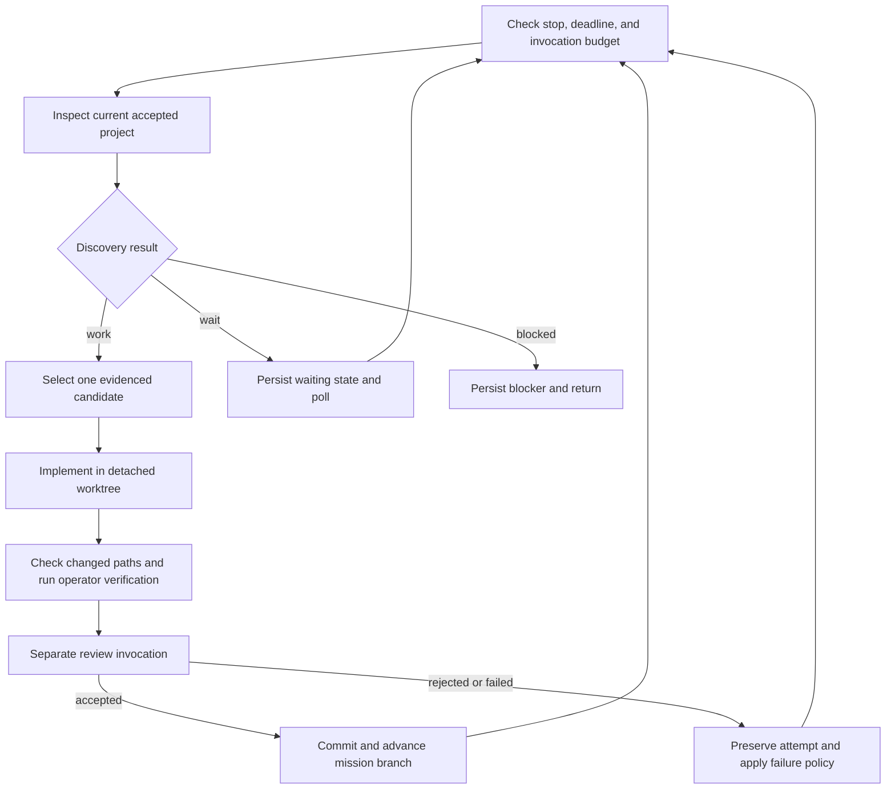

# Mission lifecycle

The mission is the persistent unit of responsibility. Tasks are temporary units
of delivery discovered while pursuing that responsibility.

## Inputs

A version-1 JSON spec supplies:

- A nonempty mission and an existing Git repository root.
- Repository-relative allowed paths and optional behavioral constraints.
- Permitted work kinds: feature, bugfix, QA, or documentation.
- Verification commands as nonempty argv arrays supplied by the operator.
- Driver choice, optional model, and one to three discovery workers.
- Required invocation and elapsed wall-time limits.

Unknown spec and limit fields are rejected. In particular, a monetary limit is
not accepted as a substitute for an enforceable invocation or time limit. Mission
state must live outside the target repository.

## Execution

Every driver invocation is reserved before it starts. Up to three discovery
workers can inspect independently. Implementations are serial, so two workers
do not independently advance the accepted branch. Discovery supplies a stable
candidate key, kind, priority, reason, evidence, and acceptance criteria. The
supervisor validates the structured response; valid JSON alone does not prove
that its evidence or priority is correct.

Candidates are de-duplicated by key, then selected by descending priority (5 is
highest) and stable key order. The next prompt includes recent task history.
Before starting an implementation attempt, the runner checks that calls remain
for both implementation and mandatory review. Discovery worker count also leaves
room for that pair when budget permits. This is a heuristic selection policy,
not an independent estimate of customer value.

An implementation's `completed` response is insufficient for acceptance.
Verification is run by the supervisor using the configured argv, and review is
a separate driver invocation. A review from the same model is not an
independent human or an infallible correctness oracle.

Before verification, the supervisor stages the implementation and materializes
the staged files using Git's checkout conversions. This includes custom
clean/smudge filters, so a check does not silently test pre-staging bytes that
will be transformed in the commit. Each command must leave the tracked content
and staged tree unchanged; a mutation blocks the mission and retains the
materialized attempt. Formatting or code generation that edits source belongs
in implementation, followed by non-mutating verification commands.

The verified tree is recorded in successful verification events and accepted
task records. Review and commit must preserve that tree. Assume-unchanged and
skip-worktree index flags are rejected before staging because they can conceal
dependencies and out-of-scope changes. Materialization does not clear ignored
artifacts or recursively restore submodules; this is not a fresh-environment
test or an OS sandbox.

Accepted work advances the mission's branch and accepted commit. It does not
finish the mission. Rejected or uncertain attempts remain inspectable. The
supervisor does not switch or edit the original checkout. Child tools retain
host permissions and access to shared Git metadata; worktrees are not a security
sandbox. No publication or deployment step is built into the loop.

Clean, completed discovery worktrees are removed; dirty or uncertain ones are
retained with an event. Implementation worktrees remain available for review.
State records include structured host errors when available. Authentication,
quota, configuration, protocol, and unclassified host failures block rather than
being fed back as a code-fix task. Explicit transient failures and known-clean
deadlines use the bounded failure policy.

## Waiting and termination

`wait` means no actionable candidate was identified in that inspection. The
mission waits for `poll_seconds` and inspects again while its limits allow.
Repeated idle inspections still consume invocations. A blocked result, failure
policy, exhausted limit, or explicit stop ends the current runner.

The wall-time window starts at the first run. Pausing the process, leaving it
offline afterward, or waiting for the next poll does not reset that window. An explicit
stop is persisted and checked before dispatch; it cannot be undone by a model
response.

## Recovery

State records calls, task outcomes, the mission branch, and the accepted head.
An unfinished call after an interruption has an unknown outcome. Automatic
replay would risk duplicating work or effects, so recovery requires explicit
operator acknowledgment. Inspect worktrees and call artifacts first. Neither
recovery nor a success-looking final message refunds spent invocations.

Recovery acknowledgment can settle an interruption or unknown cleanup. It does
not reset a stop, exhausted budget, scope violation, host blocker, or exhausted
failure policy. Resolving those conditions requires inspection and a new explicit
mission where appropriate.

Unfinished implementation or verification tasks also require recovery even if
their last model call completed. Stop and integration are serialized; work not
integrated before a stop remains inspectable. Git refs and SQLite are separate
stores: an interruption between their updates can leave a mismatch. A restart
detects it and refuses to proceed; inspect the selected commit and initialize a
new mission rather than automatically replaying or repairing it.

These are lifecycle and acceptance controls. See [limits and host support](limits-and-hosts.md)
for the separate filesystem, credential, network, and process boundaries.
