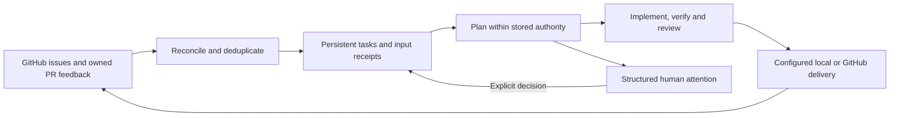

# Maintain a repository continuously

Repository mode coordinates incremental GitHub intake and the existing issue
execution engine. It keeps following owned pull requests after publication,
including CI failures and trusted review feedback, while preserving the original
scope, verification commands, delivery permissions, and finite budget.



## Start with observation

Copy [repository.json](../examples/repository.json) outside the target repository.
Set its project, repository, allowed paths, verification commands and driver.
The same prerequisites as [issue mode](issues.md) apply: committed code, a Git
identity, authenticated `gh`, and checks that work in fresh worktrees.

```console
dutyloop repository init --spec repository.json --state ../repository-state
dutyloop repository reconcile --state ../repository-state
dutyloop repository run --state ../repository-state
```

`init` captures the initial backlog without invoking a model or writing GitHub.
`reconcile` reads GitHub and updates local intake receipts; it does not invoke
models or publish changes. `run` coordinates reconciliation and execution until
stopped or limited. Use `start` instead to launch the coordinator in the background.

The default `intake.mode` is `observe`. Captured issues can be planned, consuming
the existing call budget, but are not implemented. New issues are recorded as
prospective work. Inspect status, plans and the attention list before enabling
execution explicitly:

```console
dutyloop repository status --state ../repository-state --human
dutyloop repository attention --state ../repository-state
dutyloop repository set-mode --state ../repository-state --mode auto
dutyloop repository start --state ../repository-state
```

`auto` authorizes incremental issue intake and execution within the stored
mission and delivery policy. Changing mode is recorded; it does not renew the
budget, clear a stop, or approve changed issue requirements. `queue.numbers`
restricts intake when supplied. Excluded labels and `queue.max_issues` still apply.

## One task across several attempts

The repository view links each issue to its plan, child execution attempts,
verification evidence, branch, and owned pull request. Repeated polls of the
same source do not create a new task. Input fingerprints and receipts survive
restart. An unchanged idle poll makes no model call.

Task execution stays serial. The coordinator delegates implementation, staged
snapshot verification, separate review and delivery to the existing issue and
mission engines. A worktree remains an execution directory, not a sandbox.

New requirements are evidence requiring inspection. A changed issue description,
labels or comments must not silently replace the scope that was accepted.
Missing business intent and uncertain prior effects become attention items while
other eligible issues remain runnable.

## Keep an owned pull request moving

With `github.delivery: pull_request`, DutyLoop can repair CI and handle trusted
review feedback on its own PR without permission to merge or close the issue.
The finite issue runner inspects available feedback during a pass; repository
mode keeps checking in later passes.

`github.maintain_pull_requests` defaults to `true`; set it to `false` to leave
published PRs for the maintainer. Review authors with GitHub association `OWNER`,
`MEMBER` or `COLLABORATOR`, or logins listed in `github.review_authors`, may provide
feedback for read-only reassessment. That feedback supplies context, not wider
authority. Ambiguity still requires an operator decision. Repairs retain the
owned branch and PR and count towards `queue.max_delivery_attempts`.

Merge and issue closure keep their separate [delivery gates](issues.md).
Switching intake to `auto` grants neither permission. Repository mode does not
deploy changes or relax branch protection.

## Attention, stop and recovery

```console
dutyloop repository attention --state ../repository-state
dutyloop repository resolve --state ../repository-state --number 42 --decision "Preserve the existing API and use an empty list for an empty file."
dutyloop repository events --state ../repository-state --after 0 --limit 20
dutyloop repository stop --state ../repository-state
dutyloop repository recover --state ../repository-state --acknowledge
```

Attention and task status are derived from stored facts. Answering a question
records the operator's intent against current evidence. Existing PRs must still
pass ownership, head, metadata and base checks before continuation.

The original invocation and wall-time limits span every poll, attempt, restart
and period offline. A stopped or exhausted coordinator cannot restart itself.
Unknown external results remain quarantined: recovery reads remote state and
requires acknowledgment; it does not blindly repeat a push, merge or closure.

Repository metadata and intake receipts live in the same private
`issues.sqlite3` as the issue queue. Keep state and raw host transcripts outside
the repository. Do not use finite issue commands to bypass repository observation
policy; use the repository controls for this state.

While a coordinator is recorded, idle finite passes report `watching` and expose
their stored result in `pass_status`. This lets an active desktop worker keep
polling after one pass finishes. A recorded PID is not proof of process liveness;
health labels it unverified and exposes stale observations for inspection.

## Desktop execution

Select `driver: {"name": "desktop"}` and use the existing [MCP setup](desktop.md).
The `repository_*` tools control the coordinator; desktop workers use the same
phase mailbox and fresh-context review contract as issue batches.

An active conversation must keep claiming and returning phases. The coordinator
cannot wake an idle desktop conversation or terminate its external tools. Its
executor status and attention explain when work awaits the host. Native drivers
launch their managed child processes instead.

## Configuration

Repository specifications use the [issue fields](issues.md#configuration-reference)
plus:

| Field | Default | Meaning |
| --- | --- | --- |
| `intake.mode` | `observe` | Record and plan work; `auto` also admits and executes eligible incremental issues. |
| `intake.poll_seconds` | `30` | Interval between coordinator reconciliation passes. Waiting consumes wall time. |

Repository coordination is a local process. It does not install an OS service,
provide cross-device execution, or establish long-term autonomous effectiveness.
See the [verification record](validation.md) for the boundaries actually tested.
